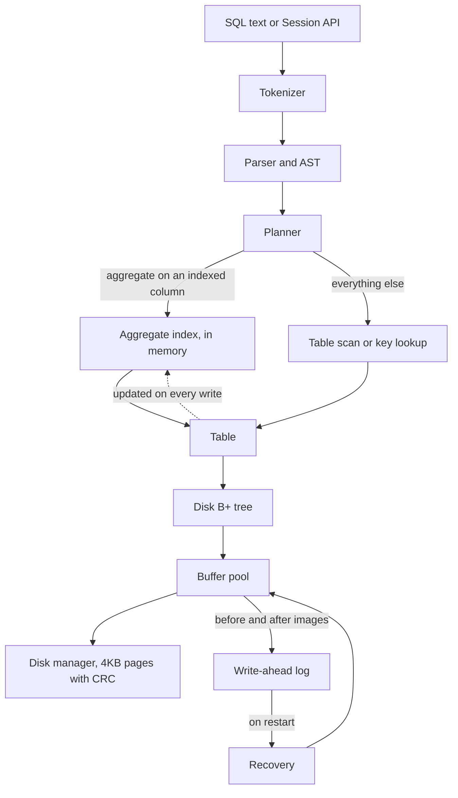

# aqo: a crash-safe storage engine with O(log n) aggregate indexes

**A C++20 database engine (B+ tree on 4KB pages, buffer pool, ARIES-style WAL and recovery, SQL subset) whose
aggregate indexes answer filtered `SUM/MIN/MAX/COUNT/AVG` in O(log n): about 100x faster than SQLite's covering
index at 1% selectivity and over 2,000x at 50% on 1M rows. It is verified by crash injection and differential fuzzing
against SQLite.**

## At a glance

| | |
|---|---|
| **Fast where it matters** | Range aggregates stay at 15-31 µs from 1% to 50% of 1M rows, because the index is O(log n). SQLite grows linearly with rows matched (1.5 ms to 81 ms). |
| **Honest about losses** | SQLite is faster at sequential bulk load (2-4x), point lookups (~4x) and full scans (7-10x). See [Results](#results). |
| **Crash-safe** | Recovers to exactly the acknowledged commits after a crash at *every* I/O point and after 62 hard process kills per test run. |
| **Tested** | 98 tests, 95% line coverage, a seeded differential fuzz against SQLite, and mutation checks that prove the tests can fail. |

The project grew out of a course toy (a CSV-backed B-tree plus array segment trees, kept unchanged in [legacy/](legacy/)).
It fixes that prototype's three known gaps: internal-node deletion (a full B+ tree with borrow/merge), the O(n log n)
`rangeSumGreaterThan` (now O(log n), see [ADR 0003](docs/adr/0003-aggregate-index.md)), and CSV-only persistence (paged
storage with a write-ahead log).

## Quickstart

You need a C++20 compiler (GCC 11+ or Clang 14+), CMake 3.20+, Ninja, GoogleTest and SQLite dev headers (SQLite is used
only by the differential test and the benchmark). On Windows use MSYS2 UCRT64:
`pacman -S mingw-w64-ucrt-x86_64-{gcc,cmake,ninja,gtest,sqlite3}`.

```bash
git clone https://github.com/AurindumBanerjee/Aggregate-Queries-Optimiser && cd Aggregate-Queries-Optimiser
cmake -S . -B build -G Ninja -DCMAKE_BUILD_TYPE=Release
cmake --build build
ctest --test-dir build -j2 --output-on-failure
./build/aqo_cli demo.db
```

The last command opens an interactive shell (`.help` lists commands). A one-shot example:

```bash
./build/aqo_cli demo.db -c "CREATE TABLE sales (id INT PRIMARY KEY, qty INT, price REAL, region TEXT);
  CREATE INDEX ON sales (qty);
  INSERT INTO sales VALUES (1,5,2.5,'n'),(2,12,1.0,'s'),(3,7,9.5,'n'),(4,20,3.0,'e');
  SELECT SUM(price), COUNT(*), AVG(qty) FROM sales WHERE qty > 6;"
```

Real output from this repo:

```text
| SUM(price) | COUNT(*) | AVG(qty) |
| 13.5       | 3        | 13.0     |
plan: INDEX AGGREGATE sales USING index(qty) RANGE (6, +inf) [O(log n)]
```

Run `./build/aqo_cli demo.db -c "SELECT COUNT(*) FROM sales;"` afterwards to see the data persisted. Prefix a statement
with `EXPLAIN` to see its plan. A `Dockerfile` and `docker-compose.yml` are included (`docker compose run --rm aqo`),
but **they have not been built or run**, because the Docker daemon was unavailable during development.

## Architecture



| Layer | What it does | Design note |
|---|---|---|
| SQL ([ADR 0007](docs/adr/0007-sql-layer.md)) | Tokenizer, recursive-descent parser, binder, rule-based planner, executor, REPL | Semantics follow SQLite (NULL logic, integer division), so SQLite can act as an oracle |
| Aggregate index ([ADR 0003](docs/adr/0003-aggregate-index.md)) | B+ tree keyed by `(value, primary key)`; every internal node caches count/sum/min/max of its subtree | In-memory derived data: rebuilt on open, rolled back through an undo log on abort |
| Disk B+ tree ([ADR 0004](docs/adr/0004-paged-btree.md)) | Clustered key-to-row tree in slotted pages, fixed root page, free list | Preemptive splits on insert; merge or redistribute on delete |
| Buffer pool ([ADR 0005](docs/adr/0005-buffer-pool.md)) | Pin counts, dirty bits, LRU or Clock eviction | Enforces the WAL rule in one place |
| WAL and recovery ([ADR 0006](docs/adr/0006-wal-recovery.md)) | CRC-framed log, checkpoints, atomic truncation, analysis/redo/undo with CLRs | Single writer makes physical undo exact |
| Concurrency ([ADR 0009](docs/adr/0009-concurrency.md)) | Many readers or one writer behind a database-level lock | Readers see only committed state |

**Life of a write.** The planner finds the table, and the table encodes the row. The disk B+ tree modifies pages through
write guards. When a guard is released, the engine diffs the page against its snapshot and appends one log record.
The table then updates the aggregate indexes. On commit the log is fsynced, and data pages stay dirty in the pool until
eviction or a checkpoint.

## Results

1,000,000 rows on an Intel i5-1240P laptop (12C/16T, 63.7 GiB RAM, NVMe SSD), Windows 11, GCC 13.1 `-O3`, SQLite 3.42.0.
Both engines use a 64 MiB cache, a WAL and an fsync per 10k-row commit. Numbers are the **median of 3 full runs, with
(min-max) in brackets**. Run-to-run variance on this laptop reached about 2.5x, so only ratios that held in all three
runs are claimed. Method, fairness choices and caveats are in [ADR 0008](docs/adr/0008-benchmark-methodology.md), and the
raw data is in [bench/results/](bench/results/).

### Where aqo wins

| Workload | aqo | SQLite |
|---|---:|---:|
| Range SUM/COUNT/MAX, 0.01% of rows (p50 µs) | 4.2 (2.7–9.7) | 22.0 (17.7–67.1) |
| Range SUM/COUNT/MAX, 1% of rows (p50 µs) | **14.9** (13.4–22.8) | 1,473 (1,354–2,547) |
| Range SUM/COUNT/MAX, 10% of rows (p50 µs) | **17.1** (16.9–29.8) | 14,466 (13,810–26,682) |
| Range SUM/COUNT/MAX, 50% of rows (p50 µs) | **30.8** (30.2–50.7) | 81,486 (70,719–118,821) |
| Insert, random primary keys (rows/s) | **79,706** (57,871–108,958) | 40,525 (26,665–45,643) |
| Insert with indexes (rows/s) | **42,047** (29,760–62,666) | 18,424 (17,048–28,847) |

### Where SQLite wins

| Workload | aqo | SQLite |
|---|---:|---:|
| Insert, sequential keys (rows/s) | 193,742 (142,058–203,785) | **744,884** (304,791–855,846) |
| Point lookup, best case for each (ops/s) | 131,640 | **541,244** |
| Aggregate with no usable index, full scan (ms) | 520 | **71** |

### Costs of the design

| Measurement | Value |
|---|---|
| Crash recovery of 100k un-checkpointed inserts | 198–487 ms |
| Reopen including aggregate-index rebuild | 5.4–10 s |


## How I know it works

* **B+ tree:** randomized insert/erase/scan against `std::map` over node orders 3-64, plus aggregates against brute force.
* **Disk tree:** the same property test with a 10-frame buffer pool (constant eviction), for both LRU and Clock.
* **Crash safety:**
  * A sweep crashes at *every* I/O point (page write, log write, fsync) of a 40-transaction workload, simulates power
    loss with torn log tails, optionally crashes again during recovery, and checks that the database equals the model
    after exactly the acknowledged commits.
  * A second test hard-kills a real worker process 62 times per run (TerminateProcess or SIGKILL) and verifies the same
    invariant.
* **SQL:** unit tests plus a seeded differential fuzz against SQLite, which compares the index plan, the scan plan and
  SQLite. Deliberately breaking range bounds made it fail, which confirms it can catch real bugs.
* **Concurrency:** readers see only committed state during a concurrent money-transfer workload, four writers lose no
  updates, and the pool survives parallel eviction.
* **Coverage:** 95.1% of lines, 98.7% of functions, 62% of branches (gcov, local run). CI gates at 70% of lines.

CI ([.github/workflows/ci.yml](.github/workflows/ci.yml)) builds Release, ASan+UBSan, ThreadSanitizer and coverage on
Linux. Sanitizers could not run locally on MinGW, so they are checked only on GitHub.

## Limitations

* **Concurrency:** single node and single writer. A write transaction blocks all readers and vice versa. There is no
  MVCC and no group commit.
* **Aggregate index memory and startup:** the indexes are in memory (about 72 bytes per row per index) and are rebuilt
  from the table on open, which took 5-10 s at 1M rows.
* **Rows and types:** a row must fit one page (at most 992 bytes encoded, no overflow pages). All columns are NOT NULL,
  and the types are INT, REAL and TEXT.
* **SQL coverage:** subset only. No joins, subqueries, HAVING, DISTINCT, prepared statements or non-aggregate secondary
  indexes.
* **Durability model:** torn *data-page* writes are detected (CRC) but not repaired. The fault model assumes atomic 4KB
  page writes.
* **Performance gaps:** scans are slow (rows decode into `std::variant`). On 32-bit-`long` platforms, `fseek` limits
  files to 2 GB.
* **Benchmark scope:** one laptop, one table shape, uniform random keys, warm cache.
* **Not yet verified:** the Docker images, the GitHub Actions workflow and the sanitizer jobs.
* **Unexplained test failure:** a crash test failed once and never reproduced in about 60 later runs. The likeliest cause,
  a transient Windows file lock during log truncation, was fixed with a retry and fallback, but the original failure
  was not captured.

## What I'd do next

1. Bulk-load the aggregate index and persist it, cutting reopen from seconds to milliseconds.
2. Add a row-oriented scan path (no `std::variant`) and prepared statements, to close the scan and point-lookup gaps.
3. Add MVCC or snapshot reads so readers do not block on a writer, and group commit to amortize fsync.
4. Add a double-write buffer or full-page images to survive torn page writes, and overflow pages for large values.
5. Run the sanitizer and TSan jobs on GitHub, fix whatever they find, and add a pinned clang-format check.
6. Add joins (hash and index nested loop) and a cost-based planner that uses the aggregate index for selectivity estimates.

## Repository map

| Path | Contents |
|---|---|
| `include/aqo/`, `src/` | The engine: B+ tree, pages, pool, WAL, recovery, aggregate index, tables, SQL |
| `tests/` | 98 tests, including crash injection, kill-9, SQLite differential fuzz and concurrency |
| `bench/` | Benchmark program, plot script, three raw runs and the merged results |
| `tools/aqo_cli.cpp` | The SQL shell |
| `docs/adr/` | Nine design records (0001 toolchain through 0009 concurrency); [docs/INTERVIEW_PREP.md](docs/INTERVIEW_PREP.md) has talking points |
| `legacy/` | The original prototype, untouched |
