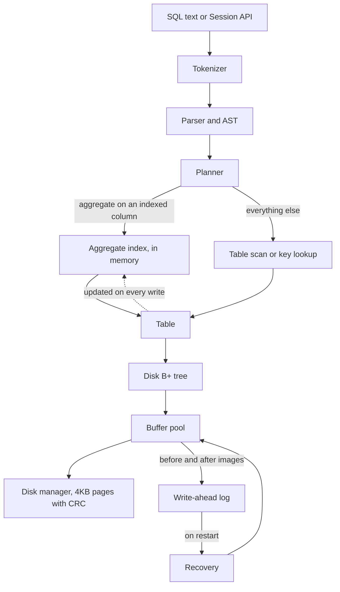

# AQO: a crash-safe storage engine with O(log n) aggregate indexes

**A C++20 database engine (B+ tree on 4KB pages, buffer pool, ARIES-style WAL and recovery, SQL subset) whose
aggregate indexes answer filtered `SUM/MIN/MAX/COUNT/AVG` in O(log n): about 100x faster than SQLite's covering
index at 1% selectivity and over 2,000x at 50% on 1M rows. It is verified by crash injection and differential fuzzing
against SQLite.**

## At a glance

| | |
|---|---|
| **Fast where it matters** | Range aggregates stay at 15-31 µs from 1% to 50% of 1M rows, because the index is O(log n). SQLite grows linearly with rows matched (1.5 ms to 81 ms). |
| **Built for range queries** | The goal was fast range aggregates, not a replacement for SQLite. SQLite is still faster at sequential bulk load (2-4x), point lookups (~4x) and full scans (7-10x), which this project never set out to beat. See [Results](#results). |
| **Crash-safe** | Recovers to exactly the acknowledged commits after a crash at *every* I/O point and after 62 hard process kills per test run. |
| **Tested** | 98 tests, 95% line coverage, a seeded differential fuzz against SQLite, and mutation checks that prove the tests can fail. |

The project grew out of a course toy (a CSV-backed B-tree plus array segment trees, kept unchanged in [legacy/](legacy/)).
It fixes that prototype's three known gaps: internal-node deletion (a full B+ tree with borrow/merge), the O(n log n)
`rangeSumGreaterThan` (now O(log n), see [ADR 0003](docs/adr/0003-aggregate-index.md)), and CSV-only persistence (paged
storage with a write-ahead log).

## Quickstart

You need a C++20 compiler (GCC 11+ or Clang 14+), CMake 3.20+, Ninja, GoogleTest and SQLite dev headers (SQLite is used
only by the differential test and the benchmark). On Windows use MSYS2 UCRT64:
`pacman -S mingw-w64-ucrt-x86_64-{gcc,cmake,ninja,gtest,sqlite3}`.

```bash
git clone https://github.com/AurindumBanerjee/Aggregate-Queries-Optimiser && cd Aggregate-Queries-Optimiser
cmake -S . -B build -G Ninja -DCMAKE_BUILD_TYPE=Release
cmake --build build
ctest --test-dir build -j2 --output-on-failure
./build/aqo_cli demo.db
```

The last command opens an interactive shell (`.help` lists commands). A one-shot example:

```bash
./build/aqo_cli demo.db -c "CREATE TABLE sales (id INT PRIMARY KEY, qty INT, price REAL, region TEXT);
  CREATE INDEX ON sales (qty);
  INSERT INTO sales VALUES (1,5,2.5,'n'),(2,12,1.0,'s'),(3,7,9.5,'n'),(4,20,3.0,'e');
  SELECT SUM(price), COUNT(*), AVG(qty) FROM sales WHERE qty > 6;"
```

Real output from this repo:

```text
| SUM(price) | COUNT(*) | AVG(qty) |
| 13.5       | 3        | 13.0     |
plan: INDEX AGGREGATE sales USING index(qty) RANGE (6, +inf) [O(log n)]
```

Run `./build/aqo_cli demo.db -c "SELECT COUNT(*) FROM sales;"` afterwards to see the data persisted. Prefix a statement
with `EXPLAIN` to see its plan. A `Dockerfile` and `docker-compose.yml` are included (`docker compose run --rm aqo`),
but **they have not been built or run**, because the Docker daemon was unavailable during development.

## Architecture



| Layer | What it does | Design note |
|---|---|---|
| SQL ([ADR 0007](docs/adr/0007-sql-layer.md)) | Tokenizer, recursive-descent parser, binder, rule-based planner, executor, REPL | Semantics follow SQLite (NULL logic, integer division), so SQLite can act as an oracle |
| Aggregate index ([ADR 0003](docs/adr/0003-aggregate-index.md)) | B+ tree keyed by `(value, primary key)`; every internal node caches count/sum/min/max of its subtree | In-memory derived data: rebuilt on open, rolled back through an undo log on abort |
| Disk B+ tree ([ADR 0004](docs/adr/0004-paged-btree.md)) | Clustered key-to-row tree in slotted pages, fixed root page, free list | Preemptive splits on insert; merge or redistribute on delete |
| Buffer pool ([ADR 0005](docs/adr/0005-buffer-pool.md)) | Pin counts, dirty bits, LRU or Clock eviction | Enforces the WAL rule in one place |
| WAL and recovery ([ADR 0006](docs/adr/0006-wal-recovery.md)) | CRC-framed log, checkpoints, atomic truncation, analysis/redo/undo with CLRs | Single writer makes physical undo exact |
| Concurrency ([ADR 0009](docs/adr/0009-concurrency.md)) | Many readers or one writer behind a database-level lock | Readers see only committed state |

**Life of a write.** The planner finds the table, and the table encodes the row. The disk B+ tree modifies pages through
write guards. When a guard is released, the engine diffs the page against its snapshot and appends one log record.
The table then updates the aggregate indexes. On commit the log is fsynced, and data pages stay dirty in the pool until
eviction or a checkpoint.

## Results

Everything below ran on one laptop with 1,000,000 rows: Intel i5-1240P (12 cores, 16 threads), 63.7 GiB RAM, NVMe SSD,
Windows 11, GCC 13.1 `-O3`, SQLite 3.42.0. Both engines got a 64 MiB cache, a write-ahead log, and an fsync after every
10,000-row commit. Each number is the **median of 3 full runs, with the (min–max) across those runs in brackets**.
Run-to-run variance on this laptop reached about 2.5x, so I only claim differences that showed up in all three runs.
The ratio column divides the two medians. How the benchmark was set up, and what I did to keep it fair, is in
[ADR 0008](docs/adr/0008-benchmark-methodology.md); the raw runs are in [bench/results/](bench/results/).

**What each row measures**

* **Range aggregate:** `SELECT COUNT(*), SUM(a), SUM(b), MAX(c) FROM t WHERE a >= lo AND a <= hi`, where the range covers
  the stated share of the 1M rows. The number is the median time for one query in microseconds (µs), so **lower is
  better**. SQLite gets a covering index on `(a, b, c)` so that it does not have to scan the table.
* **Insert:** rows written per second, so **higher is better**. Rows go in batches of 10,000 per transaction.
  "Random keys" means the primary keys arrive shuffled; "with indexes" means aqo maintains two aggregate indexes and SQLite
  maintains two ordinary secondary indexes.
* **Point lookup:** primary-key lookups per second, so **higher is better**. SQLite's figure is its best case, with all
  lookups inside one open read transaction.
* **Full scan:** the same aggregate query when no index can help, so both engines read all 1M rows. Time per query in
  milliseconds (ms), so **lower is better**.

### Where aqo wins

| Workload | Unit | aqo | SQLite | Ratio (aqo's advantage) |
|---|---|---:|---:|---:|
| Range aggregate, 0.01% of rows | µs per query, lower is better | 4.2 (2.7–9.7) | 22.0 (17.7–67.1) | 5x faster |
| Range aggregate, 1% of rows | µs per query, lower is better | **14.9** (13.4–22.8) | 1,473 (1,354–2,547) | 99x faster |
| Range aggregate, 10% of rows | µs per query, lower is better | **17.1** (16.9–29.8) | 14,466 (13,810–26,682) | 846x faster |
| Range aggregate, 50% of rows | µs per query, lower is better | **30.8** (30.2–50.7) | 81,486 (70,719–118,821) | 2,646x faster |
| Insert, random keys | rows per second, higher is better | **79,706** (57,871–108,958) | 40,525 (26,665–45,643) | 2.0x faster |
| Insert, with indexes | rows per second, higher is better | **42,047** (29,760–62,666) | 18,424 (17,048–28,847) | 2.3x faster |

### Where SQLite wins

| Workload | Unit | aqo | SQLite | Ratio (SQLite's advantage) |
|---|---|---:|---:|---:|
| Insert, sequential keys | rows per second, higher is better | 193,742 (142,058–203,785) | **744,884** (304,791–855,846) | 3.8x faster |
| Point lookup by primary key | lookups per second, higher is better | 131,640 | **541,244** | 4.1x faster |
| Aggregate over a range with no usable index (full scan) | ms per query, lower is better | 520 | **71** | 7.3x faster |

### Costs of the design

These have no SQLite counterpart: they come from how aqo is built.

| Measurement | Unit | Value | What it means |
|---|---|---:|---|
| Crash recovery of 100,000 inserts that were never checkpointed | milliseconds | 198–487 | Time to replay the log after a crash |
| Reopen with the aggregate index rebuilt | seconds | 5.4–10 | The index is in memory, so it is rebuilt from the table on every open |


The first chart plots median query latency in µs (log scale) against the share of rows matched (log scale): aqo's line
stays almost flat while SQLite's climbs with every extra row it has to read. In the second chart, the left panel shows
insert throughput in thousands of rows per second and the right panel shows lookups per second in thousands.

## Testing and verification

I put most of the testing effort where bugs are most likely and most expensive: the tree code, crash recovery, and the
aggregate index.

**The trees.** I generate long random sequences of inserts, deletes, lookups and range scans, run them against both the
in-memory and the on-disk B+ tree, and compare every answer with `std::map`. The in-memory tree is tested at node sizes
from 3 to 64, because tiny nodes force a split or merge on almost every operation. The on-disk tree runs with only 10
buffer-pool frames, so pages are evicted and reloaded constantly, once with LRU and once with Clock.

**Crashes.** There are two kinds of test.

* The first crashes the engine at every I/O point of a 40-transaction workload, one at a time: each page write, each log
  write and each fsync. After every simulated power loss (sometimes leaving a half-written record at the end of the log,
  and sometimes crashing a second time during recovery) it reopens the database and checks that it holds exactly the
  transactions that were acknowledged, nothing more and nothing less.
* The second starts a real worker process and kills it at a random moment, 62 times per run (TerminateProcess on Windows,
  SIGKILL elsewhere), then recovers and checks the same thing. Because the kill timing is random, a pass is good evidence
  but not proof.

**SQL answers.** Besides ordinary unit tests, a seeded fuzz test sends the same random statements to aqo (with and without
the aggregate index) and to SQLite, and the answers must match. To check that the fuzz test can actually fail, I broke the
index's range-bound handling on purpose. My first version missed that bug, so I changed the generator to favour
single-column ranges, and now it catches it.

**Concurrency.** One test moves money between accounts while readers keep checking that the total never changes, which
shows readers only ever see committed transactions. Others check that four competing writers lose no updates and that the
buffer pool holds up when several threads evict pages at once.

**Coverage and CI.** The tests cover 95.1% of lines, 98.7% of functions and 62% of branches (measured locally with gcov),
and CI fails below 70% of lines. The GitHub workflow ([.github/workflows/ci.yml](.github/workflows/ci.yml)) builds a
Release binary, an ASan+UBSan build, a ThreadSanitizer build and a coverage build, all on Linux. The sanitizers do not run
on MinGW, so they have never run on my machine and are only checked on GitHub.

## Limitations

* **One writer at a time.** While a write transaction is open, readers wait, and while readers are active, a writer waits.
  There is no MVCC and no group commit.
* **The aggregate index lives in memory.** It costs about 72 bytes per row per index and is rebuilt from the table every
  time the database opens, which took 5–10 s for 1M rows.
* **Rows have to be small.** A row must fit in one 4KB page (at most 992 bytes once encoded), because there are no overflow
  pages. Every column is NOT NULL, and the only types are INT, REAL and TEXT.
* **The SQL is a subset.** There are no joins, subqueries, HAVING, DISTINCT or prepared statements, and no secondary
  indexes other than the aggregate ones.
* **Torn pages are not repaired.** A data page damaged by a power loss in the middle of a write is detected (each page has
  a checksum) but not fixed. The crash tests assume 4KB page writes are atomic.
* **Scans are slow and files are capped on some platforms.** Scans decode every row into `std::variant` values, which is
  why SQLite beats them by about 7x. On platforms where `long` is 32 bits, `fseek` limits files to 2 GB.

## Future scope

1. **Make reopening fast.** Bulk-load the aggregate index from sorted data, or persist it, so opening a 1M-row database
   takes milliseconds instead of seconds. This is the biggest practical cost of the current design.
2. **Close the performance gaps.** Add a row-oriented scan path that avoids `std::variant`, plus prepared statements, to
   narrow SQLite's lead on scans and point lookups.
3. **Let readers and writers overlap.** Add MVCC or snapshot reads so readers do not wait for a writer, and group commit
   so concurrent commits share one fsync.
4. **Survive torn pages and big values.** Add a double-write buffer or full-page images in the log, and overflow pages for
   values bigger than one page.
5. **Finish the CI story.** Get the sanitizer and ThreadSanitizer jobs passing on GitHub, fix whatever they find, and add a
   formatting check with a pinned clang-format version.
6. **Grow the SQL.** Add joins (hash join and index nested loop) and a cost-based planner that uses the aggregate index to
   estimate how many rows a filter will match.

## Repository map

| Path | Contents |
|---|---|
| `include/aqo/`, `src/` | The engine: B+ tree, pages, pool, WAL, recovery, aggregate index, tables, SQL |
| `tests/` | 98 tests, including crash injection, kill-9, SQLite differential fuzz and concurrency |
| `bench/` | Benchmark program, plot script, three raw runs and the merged results |
| `tools/aqo_cli.cpp` | The SQL shell |
| `docs/adr/` | Nine design records (0001 toolchain through 0009 concurrency); [docs/INTERVIEW_PREP.md](docs/INTERVIEW_PREP.md) has talking points |
| `legacy/` | The original prototype, untouched |
