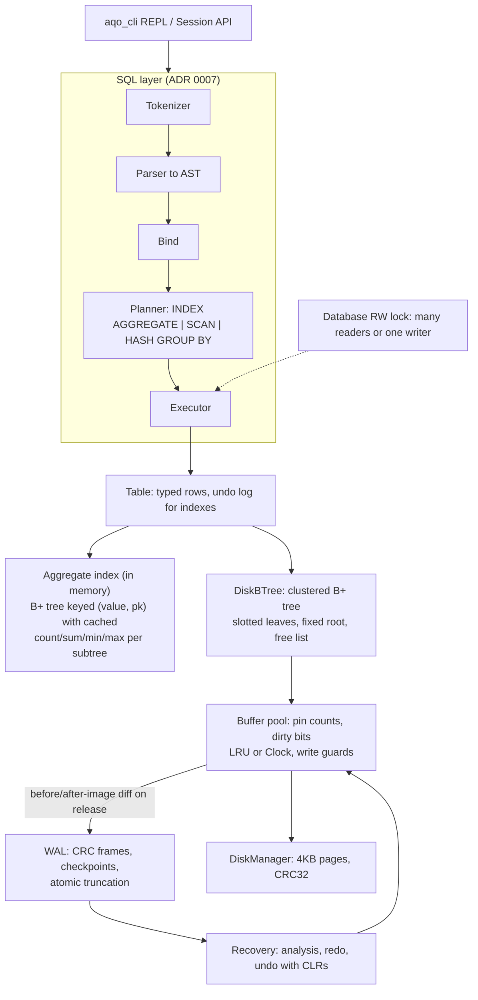
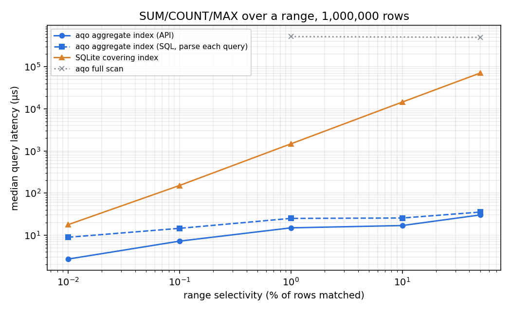
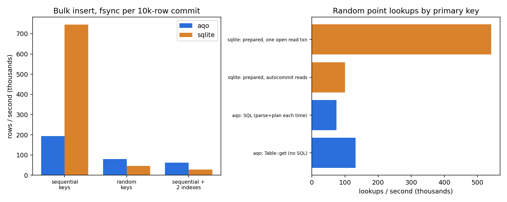

# aqo — a crash-safe single-node storage engine with O(log n) aggregate indexes

**A C++20 database engine (B+ tree on 4KB pages, buffer pool, ARIES-style WAL and recovery, SQL subset) whose
aggregate indexes answer filtered `SUM/MIN/MAX/COUNT/AVG` in O(log n) — about 100x faster than SQLite's covering
index at 1% selectivity and over 2,000x at 50% on 1M rows — and that is checked by crash injection and differential
fuzzing against SQLite.**

It grew out of a course toy (a CSV-backed B-tree plus array segment trees, preserved unchanged in [legacy/](legacy/));
the three gaps in that prototype are fixed: internal-node deletion (full B+ tree with borrow/merge), the O(n log n)
`rangeSumGreaterThan` (now O(log n), see [ADR 0003](docs/adr/0003-aggregate-index.md)), and CSV-only persistence
(paged storage with a write-ahead log).

## Architecture



## Quickstart (5 commands)

Needs a C++20 compiler (GCC 11+/Clang 14+), CMake 3.20+, Ninja, GoogleTest and SQLite dev headers (SQLite only for
the differential test and benchmark). On Windows use MSYS2 UCRT64 (`pacman -S mingw-w64-ucrt-x86_64-{gcc,cmake,ninja,gtest,sqlite3}`).

```bash
git clone https://github.com/AurindumBanerjee/Aggregate-Queries-Optimiser && cd Aggregate-Queries-Optimiser
cmake -S . -B build -G Ninja -DCMAKE_BUILD_TYPE=Release
cmake --build build
ctest --test-dir build -j8 --output-on-failure
./build/aqo_cli demo.db -c "CREATE TABLE sales (id INT PRIMARY KEY, qty INT, price REAL, region TEXT); CREATE INDEX ON sales (qty); INSERT INTO sales VALUES (1,5,2.5,'n'),(2,12,1.0,'s'),(3,7,9.5,'n'),(4,20,3.0,'e'); SELECT SUM(price), COUNT(*), AVG(qty) FROM sales WHERE qty > 6;"
```

Output of the last command (real, from this repo):

```
| SUM(price) | COUNT(*) | AVG(qty) |
| 13.5       | 3        | 13.0     |
plan: INDEX AGGREGATE sales USING index(qty) RANGE (6, +inf) [O(log n)]
```

Close the process and run `./build/aqo_cli demo.db -c "SELECT COUNT(*) FROM sales;"` to see the data persisted. A
`Dockerfile` and `docker-compose.yml` are provided (`docker compose run --rm aqo`); **they have not been built or run**
(the Docker daemon was unavailable while developing).

## Results

1,000,000 rows, Intel i5-1240P laptop (12C/16T, 63.7 GiB RAM, NVMe SSD), Windows 11, GCC 13.1 `-O3`, SQLite 3.42.0.
Both engines: 64 MiB cache, WAL, fsync per 10k-row commit. **Median of 3 full runs, (min–max) in brackets.** Run-to-run
variance on this laptop reached ~2.5x, so only ratios that held in all three runs are claimed. Method, fairness choices
and caveats: [ADR 0008](docs/adr/0008-benchmark-methodology.md); raw data in [bench/results/](bench/results/).

| Workload | aqo | SQLite |
|---|---:|---:|
| Range SUM/COUNT/MAX, 0.01% of rows (p50 µs) | 4.2 (2.7–9.7) | 22.0 (17.7–67.1) |
| Range SUM/COUNT/MAX, 1% of rows (p50 µs) | **14.9** (13.4–22.8) | 1,473 (1,354–2,547) |
| Range SUM/COUNT/MAX, 10% of rows (p50 µs) | **17.1** (16.9–29.8) | 14,466 (13,810–26,682) |
| Range SUM/COUNT/MAX, 50% of rows (p50 µs) | **30.8** (30.2–50.7) | 81,486 (70,719–118,821) |
| Insert, random primary keys (rows/s) | **79,706** (57,871–108,958) | 40,525 (26,665–45,643) |
| Insert + indexes (rows/s) | **42,047** (29,760–62,666) | 18,424 (17,048–28,847) |
| Insert, sequential keys (rows/s) | 193,742 (142,058–203,785) | **744,884** (304,791–855,846) |
| Point lookup, best case each (ops/s) | 131,640 | **541,244** |
| Aggregate with no usable index, full scan (ms) | 520 | **71** |
| Crash recovery of 100k un-checkpointed inserts | 198–487 ms | n/a |
| Reopen incl. aggregate-index rebuild | 5.4–10 s | n/a |




aqo wins where the aggregate index applies and on random-key inserts. **SQLite is faster** at sequential bulk load
(2–4x), point lookups (about 4x once its read-transaction overhead is excluded) and scans (7–10x).

## What is tested (98 tests, 95% line coverage)

* **B+ tree**: randomized insert/erase/scan against `std::map` over orders 3–64, plus aggregate-vs-brute-force.
* **Disk tree**: the same property test with a 10-frame buffer pool (constant eviction), LRU and Clock.
* **Crash safety**: a sweep that crashes at *every* I/O point (page write, log write, fsync) of a 40-transaction
  workload, simulates power loss with torn log tails, optionally crashes again during recovery, and checks the database
  equals the model after exactly the acknowledged commits; and a test that **hard-kills a real worker process** 62
  times per run (TerminateProcess/SIGKILL) and verifies the same invariant.
* **SQL**: unit tests plus a seeded **differential fuzz against SQLite** (index plan, scan plan and SQLite must agree).
  Mutation checks (deliberately breaking range bounds) confirmed the tests fail when the code is wrong.
* **Concurrency**: readers observe only committed state under a concurrent money-transfer workload; no lost updates
  with four writers; thread-safe pool under eviction.
* Coverage: 95.1% of lines, 98.7% of functions, 62% of branches (gcov, local run). CI gates at 70% of lines.

CI ([.github/workflows/ci.yml](.github/workflows/ci.yml)) builds Release, ASan+UBSan, ThreadSanitizer and coverage on
Linux. **It has not run yet** (nothing is pushed), and ASan/TSan could not be run locally on MinGW.

## Design decisions

[docs/adr/](docs/adr/): 0001 toolchain · 0002 B+ tree · 0003 aggregate index (and why it is not a literal segment tree)
· 0004 paged B+ tree · 0005 buffer pool · 0006 WAL and recovery · 0007 SQL layer · 0008 benchmarks · 0009 concurrency.

## Limitations

* Single node, single writer: a write transaction blocks all readers and vice versa; no MVCC, no group commit.
* Aggregate indexes are in memory (about 72 bytes/row/index) and rebuilt from the table on open (5–10 s at 1M rows).
* Rows must fit one page: at most 992 bytes encoded (no overflow pages). All columns are NOT NULL; types are INT, REAL, TEXT.
* SQL subset only: no joins, subqueries, HAVING, DISTINCT, prepared statements or secondary non-aggregate indexes.
* Torn *data-page* writes are detected (CRC) but not repaired (no double-write buffer); the fault model assumes atomic 4KB writes.
* Scans are slow (rows decode into `std::variant`); `fseek` offsets limit files to 2 GB on 32-bit-`long` platforms.
* Benchmarks are one laptop, one table shape, uniform random keys, warm cache.
* Unverified here: Docker images, the GitHub Actions workflow, and the ASan/UBSan/TSan jobs.
* One crash-test failure was seen once and not reproduced in about 60 later runs; the likeliest cause (a transient
  Windows file lock during log truncation) was fixed with retry-and-fallback, but the original failure was not captured.

## What I'd do next

1. Bulk-load the aggregate index and persist it, cutting reopen from seconds to milliseconds.
2. A row-oriented scan path (no `std::variant`) and prepared statements, to close the scan and point-lookup gaps.
3. MVCC or snapshot reads so readers do not block on a writer; group commit to amortize fsync.
4. Double-write buffer or full-page images to survive torn page writes; overflow pages for large values.
5. Run the sanitizer/TSan CI on GitHub, fix whatever it finds, and add a pinned clang-format check.
6. Joins (hash and index nested loop) and a cost-based planner using the aggregate index for selectivity estimates.
